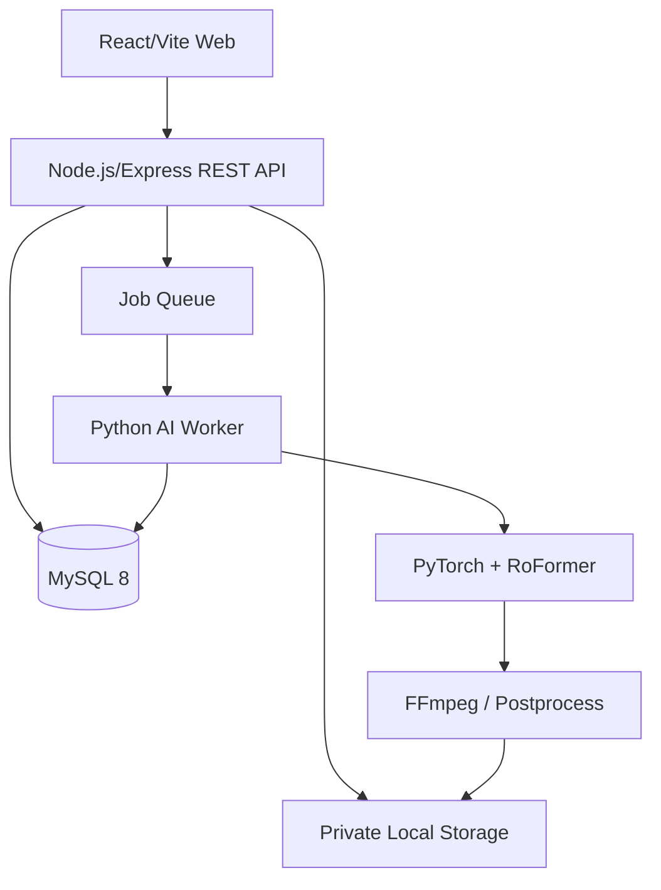
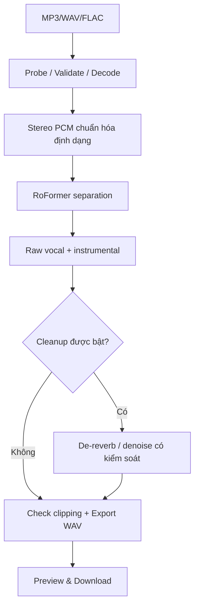

# KẾ HOẠCH DỰ ÁN — VOCAL STUDIO AI

> Phiên bản tài liệu: 1.2 · Ngày lập: 26/10/2026 · Cập nhật: 27/10/2026 · Trạng thái: Epic 4 frontend local
> Vị trí đích trên Windows: `E:\PJ_HOC_TAP\tach-vocal`
> Công nghệ: React + Vite + Tailwind CSS · Node.js + Express · Python + PyTorch · MySQL 8 · FFmpeg
> Ngân sách: ưu tiên miễn phí, mã nguồn mở; không mặc định có GPU/cloud miễn phí.

## 1. Tổng quan dự án

### 1.1. Vấn đề và mục tiêu

Người remix, producer, ca sĩ cover và người dùng phổ thông cần tách bản nhạc hỗn hợp thành vocal và instrumental để nghe, biên tập hoặc mix lại. Nhiều bản tách còn nhạc nền lọt vào, mất phụ âm, méo tiếng hoặc bị hiệu ứng kim loại.

**Mục tiêu sản phẩm:** website dễ sử dụng, tách vocal sạch tối đa trong giới hạn của mô hình AI, giữ giọng tự nhiên, xuất WAV và cho phép đánh giá kết quả trước khi tải. **Không cam kết** tái tạo hoàn hảo bản vocal studio gốc từ bản master đã trộn.

**Ưu tiên quyết định:** chất lượng tách vocal > độ ổn định > trải nghiệm > tốc độ > mở rộng tính năng. Tuy nhiên phải có ngưỡng tài nguyên để tránh treo máy.

### 1.2. Người dùng mục tiêu

| Nhóm | Nhu cầu | Kết quả cần |
|---|---|---|
| Producer/Remixer | Lấy vocal để phối lại | WAV sạch, ít bleeding, giữ phụ âm |
| Người làm karaoke | Lấy instrumental | Nhạc nền ít tiếng hát |
| Người học làm nhạc | Thử nghiệm source separation | Giao diện trực quan, so sánh model |

### 1.3. Phạm vi

**MVP v1.0:** upload MP3/WAV/FLAC; xác thực định dạng; quản lý job; chạy một model được benchmark; tạo vocal + instrumental WAV; theo dõi trạng thái; nghe thử; tải về; tự dọn file; chống truy cập trái phép.

**v1.1:** hai model có thể chọn, nghe A/B, bảng so sánh, cấu hình benchmark.

**v1.2:** de-reverb/denoise tùy chọn, lưu cả raw và cleaned, giám sát artifacts.

**v2.0 (ngoài phạm vi MVP):** đăng nhập, nhiều stem, tách lead/backing, hàng đợi phân tán, GPU cloud, thanh toán, sử dụng thương mại.

**Không làm trong MVP:** tự huấn luyện model, tích hợp API AI trả phí, nhận link YouTube để tải nội dung, hứa hẹn vocal 100% như studio, mở hệ thống cho số lượng người dùng không giới hạn.

## 2. Kiến trúc và thiết kế công nghệ



### 2.1. Quyết định kiến trúc (ADR)

| ID | Quyết định | Lý do |
|---|---|---|
| ADR-01 | Node.js/Express làm backend | API upload, job, download; dễ tích hợp React |
| ADR-02 | Python worker độc lập | Hệ sinh thái PyTorch/model tách nguồn |
| ADR-03 | Một worker, một job tại MVP | Hạn chế RAM/VRAM, tránh xử lý song song vượt tài nguyên |
| ADR-04 | MySQL lưu metadata, không lưu blob audio | DB gọn, file dễ cleanup |
| ADR-05 | Local storage lúc đầu | Không phụ thuộc phí dịch vụ; nâng cấp object storage sau |
| ADR-06 | Raw vocal luôn được lưu cùng bản optional cleaned | Người dùng không mất bản ít xử lý nhất |
| ADR-07 | Benchmark model trước khi chốt | Chất lượng phụ thuộc thể loại và checkpoint |

### 2.2. Cấu trúc repository đích

```text
tach-vocal/
├── frontend/                # React, Vite, Tailwind
├── backend/                 # Node.js Express API
│   ├── src/{config,controllers,routes,services,middlewares,workers}/
│   └── prisma/
├── ai-worker/               # Python benchmark, inference, postprocess
├── config/                  # Model registry & runtime configuration
├── docs/                    # Specs, ADR, benchmark, test reports
├── samples/                 # Không commit audio mẫu
├── results/                 # Không commit đầu ra benchmark
├── storage/                 # Không commit file người dùng
├── .env.example
├── .gitignore
└── docker-compose.yml      # Sau Phase 1
```

### 2.3. Hợp đồng Node ↔ Python

- Node tạo job `QUEUED` trong DB, worker khóa/nhận job theo thứ tự.
- Python đọc thông tin input/config đã được Node xác thực, chỉ truy cập thư mục được phép.
- Worker báo `PROCESSING`, sau đó `COMPLETED` hoặc `FAILED`; đồng thời cập nhật progress ở các mốc xác định (không giả lập phần trăm theo thời gian).
- Tác vụ có timeout, giới hạn tài nguyên, cơ chế thu hồi job treo, ghi log có `job_id`.
- File đầu ra được ghi tạm rồi đổi tên atomically sau khi hoàn tất; file chưa xong không hiển thị là kết quả hợp lệ.
- Với MVP có thể dùng DB-backed queue; Redis/BullMQ chỉ bổ sung khi có nhiều worker hoặc cần throughput cao.

## 3. Pipeline chất lượng âm thanh



### 3.1. Model ứng viên và chọn lựa

| Model | Mục đích | Mức ưu tiên | Ghi chú |
|---|---|---|---|
| BS-RoFormer Viperx 1297 | Vocal/instrumental | P0 | Ứng viên chính cần đo thực tế |
| Mel-Band RoFormer vocal | Vocal/instrumental | P0 | Đối chứng, không mặc định tốt hơn/kém hơn |
| HTDemucs | Baseline hoặc đa stem | P1 | Chỉ triển khai sau khi có số đo |
| UVR de-reverb | Hậu xử lý optional | P1 | Không bật tự động, có thể làm méo vocal |

Kiểm tra **giấy phép checkpoint riêng biệt**, nguồn tải và checksum trước khi triển khai công khai. Giấy phép repository chứa mã nguồn không tự động áp dụng cho mọi trọng số model.

### 3.2. Tiêu chí benchmark

Tập thử nghiệm tối thiểu **20 đoạn audio 20–30 giây**, gồm ballad, rap, EDM, giọng nam/nữ, harmony, reverb dày, bass/trống mạnh. Dùng audio được sở hữu hoặc được phép xử lý. Hai model phải chạy cùng file đầu vào và thiết lập công bằng.

| Chỉ số nghe mù | Trọng số | Quy ước 5/5 |
|---|---:|---|
| Độ rõ/tự nhiên của vocal | 30% | Rõ, không robot |
| Ít instrument bleed | 25% | Hầu như không nghe nhạc lọt |
| Ít artifacts | 20% | Không metallic/chirping/rè |
| Giữ đầy đủ âm tiết/hơi thở | 15% | Không mất phụ âm, không đứt câu |
| Sử dụng để remix | 10% | Dùng được trong DAW |

Chấm nghe ở âm lượng tương đương, ẩn tên model, ghi time-to-process, peak RAM/VRAM, lỗi OOM/timeout. Có stem gốc thì mới tính SI-SDR/SDR tham chiếu (sau căn chỉnh phù hợp); không tự suy đoán metric nếu chỉ có bản mix.

**Cổng quyết định P1 → P2:** chọn model chính khi có ≥20 kết quả benchmark hợp lệ, số đo hiệu năng, lỗi được ghi đầy đủ và cấu hình phần cứng đủ chạy. Nếu không đạt: giảm độ dài file giới hạn, đánh giá model nhẹ hơn hoặc yêu cầu GPU; không xây backend với lời hứa chất lượng chưa kiểm chứng.

### 3.3. Output

- `vocals_raw.wav` và `instrumental.wav` ở sample rate phù hợp pipeline; lưu metadata chính xác.
- `vocals_clean.wav` chỉ tạo nếu chạy hậu xử lý.
- Không upscale sample rate để quảng cáo chất lượng; WAV không khôi phục chất lượng đã mất do nén đầu vào.
- Validate duration, số channel, file không rỗng, clipping/NaN trước khi trả download.

## 4. API & Database

### 4.1. REST API v1

| Method | Route | Mục đích | AC |
|---|---|---|---|
| POST | `/api/v1/jobs` | Upload, validate, tạo job | Trả 202 + job id/token; không chạy AI trong request |
| GET | `/api/v1/jobs/:id` | Status/progress | Đúng token, trả status hợp lệ |
| GET | `/api/v1/jobs/:id/preview?stem=vocals` | Stream preview | Range request, chỉ file đã hoàn tất |
| GET | `/api/v1/jobs/:id/download?stem=vocals` | Tải stem | Header phù hợp; không path traversal |
| DELETE | `/api/v1/jobs/:id` | Hủy và yêu cầu xóa | Không làm hỏng job khác |
| GET | `/api/v1/models` | Danh sách model thực sự khả dụng | Không quảng cáo checkpoint chưa tải |
| GET | `/api/v1/health` | Health check API | Không tiết lộ secrets |

**Status:** `QUEUED`, `PROCESSING`, `COMPLETED`, `FAILED`, `CANCELLED`, `EXPIRED`.

### 4.2. MySQL entity tối thiểu

`audio_jobs`: `id UUID`, `original_filename`, `input_path`, `model_id`, `status`, `progress`, `output_vocal_path`, `output_instrumental_path`, `output_clean_path (nullable)`, `error_code`, `error_message (sanitized)`, `created_at`, `started_at`, `finished_at`, `expires_at`, `attempt_count`.

Không cần bảng `users` trong MVP. Dùng job access token ngẫu nhiên đủ mạnh, lưu hash, không để token trong log. Sau này có thể thêm `users` và quan hệ sở hữu.

### 4.3. Yêu cầu bảo mật và vận hành

- Kiểm tra dung lượng, thời lượng, magic bytes/FFprobe, định dạng codec; không tin MIME hay extension từ trình duyệt.
- Giới hạn tốc độ request và số job đang chờ; chống disk exhaustion, zip bomb/codec bất thường.
- Không truyền filename thô vào shell; gọi binary với argument array, không `shell: true`.
- Path lưu file do server sinh; không cho client điều khiển đường dẫn đầu ra.
- Giới hạn bộ nhớ, timeout, CPU/GPU; một worker xử lý một job.
- Không log token, thông tin nhạy cảm hoặc nguyên văn file audio; không để thư mục storage public.
- TTL xóa file theo chính sách (đề xuất 24h với MVP) và hiển thị chính sách cho người dùng.
- Chỉ xử lý audio người dùng có quyền tải lên; chuẩn bị terms/privacy trước khi public.

## 5. UI/UX

| Màn hình | Chức năng | MVP? |
|---|---|---|
| Upload | Drag/drop, file picker, format, model, giới hạn | Có |
| Processing | Queue, status, progress mốc thật, cancel | Có |
| Results | Nghe Original/Vocals/Instrumental, tải WAV | Có |
| Compare A/B | So sánh 2 model theo cùng bài | v1.1 |
| Studio Clean | Raw/Clean, tùy chọn dereverb | v1.2 |
| History/account | Lịch sử và quản lý file | v2.0 |

Responsive tối thiểu các kích cỡ: iPhone XS (375px), tablet (768px), desktop (1280px). Waveform có thể dùng thư viện chuyên dụng; phải tránh tải toàn bộ WAV lớn vào bộ nhớ frontend nếu không cần.

## 6. Backlog Epic / Task

Ký hiệu: **P0** = bắt buộc MVP, **P1** = cải thiện tiếp theo; trạng thái ban đầu `TODO` trừ các công cụ benchmark khung đã tạo trong phiên làm việc nhưng chưa benchmark thật.

### EPIC-01 — Project Foundation (Tuần 1)

Cập nhật 27/10/2026: quay lại hoàn thiện Epic 1 trước theo yêu cầu người dùng.
**EPIC-01: DONE trên máy Windows hiện tại.** FND-01/02 đã có báo cáo và cấu trúc
repository; FND-03 đã cài lại 61 package vào venv mới và 80 package Node vào
thư mục mới từ lockfile/cache. Dependency check, import, WAV I/O và kiểm tra
nền tảng đạt. FND-04/05 có setup Windows, ESLint, Prettier và test runner.
Chưa kiểm chứng trên host Windows khác; trạng thái Epic 3 cập nhật bên dưới.
Chi tiết: [trạng thái Epic 1](docs/reports/epic-01-foundation.md).
Người dùng đã chấp nhận chất lượng cấu hình 8 giây và bỏ benchmark mở rộng;
không coi AI-04/05/06 đã hoàn tất theo tiêu chí ban đầu. Giấy phép model vẫn mở.

| ID | Task | Priority | Done when |
|---|---|---|---|
| FND-01 | Kiểm tra CPU/RAM/GPU, Python, Node, FFmpeg trên Windows | P0 | Có báo cáo môi trường thực tế |
| FND-02 | Khởi tạo monorepo, ignore audio/model/env | P0 | Cấu trúc chuẩn, không commit file lớn |
| FND-03 | Thiết lập Python venv + Node package manager | P0 | Cài từ clean environment |
| FND-04 | Tạo `.env.example`/README/ADR | P0 | Người khác có thể setup theo tài liệu |
| FND-05 | Thiết lập ESLint, Prettier, test runner | P0 | Scripts chạy thành công |

### EPIC-02 — AI Quality Benchmark (Tuần 1–3)

Cập nhật 27/10/2026: **đã chốt bàn giao chất lượng cho phát triển local theo
phạm vi người dùng điều chỉnh**, chưa DONE toàn bộ tiêu chí gốc. Chọn Mel
Viperx 1143, segment 801/overlap 4/CPU FP32/2 threads; không fallback tự động.
AI-04/05/06 phần benchmark mở rộng được miễn theo yêu cầu dừng kiểm thử.
AI-01 còn mở ở giấy phép weights; AI-08 hoãn. Không chạy lại toàn bài.
Xem [trạng thái từng task](docs/reports/epic-02-ai-handoff.md) và
[ADR-002](docs/ADR-002-local-ai-selection.md). Backend local được triển khai ở Epic 3 bên dưới.

| ID | Task | Priority | Done when |
|---|---|---|---|
| AI-01 | Xác minh nguồn và giấy phép model | P0 | Manifest model, checksum, license notes |
| AI-02 | Chạy thử BS-RoFormer 30 giây | P0 | Có 2 WAV, timing, log |
| AI-03 | Chạy thử Mel-Band RoFormer cùng input | P0 | Có 2 WAV, timing, log |
| AI-04 | Xây bộ dữ liệu 20 đoạn hợp lệ | P0 | Có inventory và phân loại |
| AI-05 | Benchmark từng model trên mọi mẫu | P0 | CSV timing, lỗi, output |
| AI-06 | Blind listening test | P0 | Bảng điểm 5 tiêu chí |
| AI-07 | Chọn model chính/dự phòng | P0 | ADR ghi quyết định và đánh đổi |
| AI-08 | Prototype de-reverb optional | P1 | Raw/Clean + đánh giá artifacts |

### EPIC-03 — Backend Node.js (Tuần 3–5)

**27/10/2026 — BE-01 đến BE-08: DONE cho phạm vi local trên nhánh `develop`.**
Đã có API upload/FFprobe, MySQL/Prisma migration, queue một worker,
Python inference, status, token, Range preview/download, hủy/timeout/RAM guard/TTL.
Kiểm tra: 8/8 API integration tests, 3/3 worker supervision tests, lint/format,
schema và migration lặp lại an toàn đều đạt. Một job AI thật 1 giây đã đi qua
API → MySQL → worker → COMPLETED → tải đủ 2 WAV và preview 206.
Đây là kiểm tra tích hợp, không phải benchmark chất lượng hay nghiệm thu toàn bài.
Xem [báo cáo Epic 3](docs/reports/epic-03-backend.md) và
[hướng dẫn chạy](backend/README.md). Chưa triển khai frontend/public.

| ID | Task | Priority | Done when |
|---|---|---|---|
| BE-01 | Khởi tạo Express, config, logging, health | P0 | Health 200, config validation |
| BE-02 | Prisma schema và migration MySQL | P0 | Migration chạy lặp lại an toàn |
| BE-03 | API upload, FFprobe validation, storage | P0 | File hợp lệ nhận, file lỗi bị từ chối |
| BE-04 | Queue: enqueue/claim/progress/recovery | P0 | Restart không mất trạng thái sai |
| BE-05 | Node ↔ Python worker integration | P0 | Một job tạo WAV hoàn chỉnh |
| BE-06 | Preview + download có token | P0 | Stream/range + chống truy cập trái phép |
| BE-07 | Cancel/timeout/cleanup | P0 | Không rò file/process |
| BE-08 | Rate limit, sanitize log, error handler | P0 | Test abuse cases chính |

### EPIC-04 — Frontend React (Tuần 4–6)

**27/10/2026 — FE-01–FE-06: DONE cho P0 local trên `feature/frontend`.**
Đã có upload/drag-drop, tiến độ/hủy/reload, 3 player, download WAV có xác thực,
giao diện responsive và hướng dẫn. Browser tests 4/4 và API tests 8/8 đạt;
build production thành công. Không chạy thêm AI benchmark; FE-07 A/B P1 hoãn.
Live QA kết nối backend thật tại 1280/768/375 px đạt, không tràn ngang và không
có lỗi accessibility tự động được phát hiện trong màn hình đã kiểm tra.
Chi tiết và kiểm tra live: [báo cáo Epic 4](docs/reports/epic-04-frontend.md),
[hướng dẫn frontend](frontend/README.md).

| ID | Task | Priority | Done when |
|---|---|---|---|
| FE-01 | Khởi tạo Vite/Tailwind, layout và theme | P0 | Build thành công |
| FE-02 | Upload UI và validation | P0 | File picker, drag/drop, lỗi rõ |
| FE-03 | Processing status/polling/cancel | P0 | Không hiển thị tiến độ giả |
| FE-04 | Result audio player cho 3 stem | P0 | Play/pause/seek hoạt động |
| FE-05 | Download WAV, error/empty states | P0 | File đúng, UX rõ |
| FE-06 | Responsive/accessibility | P0 | Không tràn trên 375px, bàn phím dùng được |
| FE-07 | A/B Compare | P1 | So sánh 2 kết quả rõ ràng |

### EPIC-05 — Testing, Security, Performance (Tuần 6–7)

| ID | Task | Priority | Done when |
|---|---|---|---|
| QA-01 | Unit test API validation/status | P0 | Pass |
| QA-02 | Integration test upload → worker → download | P0 | Pass với fixture hợp lệ |
| QA-03 | Test file hỏng, oversize, unsupported codec | P0 | Trả lỗi an toàn |
| QA-04 | Test timeout, OOM, restart, cancel | P0 | Không treo job vĩnh viễn |
| QA-05 | Test token, path traversal, rate limit | P0 | Không tải file trái phép |
| QA-06 | Test âm thanh: clipping, duration, metadata | P0 | Không có output rỗng/hỏng |
| QA-07 | So sánh hiệu năng CPU/GPU | P0 | Có report thực tế |

### EPIC-06 — Release MVP (Tuần 8)

| ID | Task | Priority | Done when |
|---|---|---|---|
| REL-01 | Docker Compose hoặc scripts local nhất quán | P0 | Clean setup chạy được |
| REL-02 | README cài Windows, troubleshooting | P0 | Làm theo từng bước thành công |
| REL-03 | Kiểm thử end-to-end và audit secrets | P0 | Có test report, không lộ khóa/file |
| REL-04 | Release candidate MVP local | P0 | Demo upload → vocal WAV hoàn chỉnh |
| REL-05 | Đánh giá readiness trước khi public | P0 | Quyết định GO/NO-GO rõ ràng |

## 7. Lịch 8 tuần và mốc bàn giao

| Tuần | Trọng tâm | Deliverable | Gate |
|---|---|---|---|
| 1 | Môi trường + AI thử 1 mẫu | Environment report, raw stems | Model chạy được |
| 2 | Hai model + dữ liệu mẫu | Benchmark CSV, sample outputs | Có số đo công bằng |
| 3 | Chốt model; API foundation | Model ADR, API scaffold, DB | Quyết định AI rõ ràng |
| 4 | API upload/queue/worker | Endpoint xử lý end-to-end | Một job hoàn tất |
| 5 | API hoàn thiện + frontend upload | Preview/download, upload UI | Có kết quả qua API |
| 6 | React result studio | Người dùng thao tác end-to-end | UI chức năng đủ |
| 7 | Security/performance QA | Test report, fix list | Lỗi P0 đã sửa |
| 8 | Tài liệu và MVP release | Local MVP và demo | GO/NO-GO |

Đây là ước tính một người làm đều. Không xem timeline là cam kết khi máy không có GPU phù hợp hoặc checkpoint gặp vấn đề tương thích.

## 8. Definition of Done (DoD)

Một task chỉ được chuyển `DONE` khi: code có kiểm thử tương ứng, không có secret/model/audio nhạy cảm trong Git, có xử lý lỗi, tài liệu cập nhật, và build/test liên quan chạy thành công. Nếu chưa kiểm được do thiếu phần cứng, ghi `BLOCKED`, không tự đánh dấu PASS.

**MVP được nghiệm thu khi:**

1. Upload MP3/WAV/FLAC hợp lệ; từ chối file hỏng/quá giới hạn.
2. Có job ID, status thật, timeout/cancel/retry chính sách rõ.
3. AI xuất WAV vocal và instrumental nghe được, không clip bất thường.
4. UI nghe, seek, tải file và hiển thị lỗi chính xác.
5. File của job khác không thể truy cập bằng cách đoán ID.
6. Server khởi động lại không bỏ quên job treo.
7. Có báo cáo benchmark thực trên ít nhất 20 mẫu và model được lựa chọn có căn cứ.
8. Chạy được trên môi trường đích đã xác nhận, có tài liệu setup.

## 9. Rủi ro và ứng phó

| Rủi ro | Ảnh hưởng | Giảm thiểu |
|---|---|---|
| Không có GPU, RoFormer rất chậm | Cao | Test 30s, giảm giới hạn file, chọn model nhẹ hơn/đổi môi trường |
| OOM, VRAM thiếu | Cao | Một job/worker, chia chunk, cấu hình timeout |
| Checkpoint thiếu hoặc license mơ hồ | Cao | Model registry, kiểm tra license và nguồn trước public |
| Denoise làm méo phụ âm | Cao | Giữ raw, postprocess optional, blind test |
| File tải lên chứa dữ liệu riêng tư | Cao | Storage private, TTL, token, không log nội dung |
| Upload phá ổ đĩa | Cao | Quota, rate limit, cleanup, max duration/size |
| Audio thương mại và quyền tác giả | Cao | Điều khoản sử dụng, upload có quyền, không phân phối thư viện audio |
| Tài nguyên miễn phí không chịu nổi nhiều người | Cao | MVP local, giới hạn queue, chỉ public khi có capacity plan |
| Scope creep | Trung bình | Khóa MVP P0, P1/P2 sau nghiệm thu |

## 10. Chiến lược Git và phối hợp

- Không code trực tiếp `main`/`dev` khi repository đã tồn tại; dùng `feature/*`, `fix/*`, `chore/*`, `test/*`.
- Không tự `push`, `merge`, rebase shared branch, xóa branch hoặc force-push.
- Commit theo phạm vi, ghi report test/build/benchmark sau mỗi phase.
- `.gitignore`: `.env`, `node_modules`, `.venv`, audio upload và sample có bản quyền, output WAV, checkpoints, cache, model weights.
- Không tự chạy command tiêu tốn chi phí, tải model lớn hoặc mở dịch vụ public khi chưa xác nhận điều kiện.

## 11. Việc cần thực hiện ngay (Sprint 0 / Phase 1)

1. Trên Windows, xác nhận `E:\PJ_HOC_TAP\tach-vocal` và cấu hình CPU/RAM/GPU.
2. Chạy script `ai-worker/check_environment.py` từ bộ Phase 1 đã tạo.
3. Xác nhận Python/FFmpeg/PyTorch/audio-separator và model registry.
4. Dùng audio 20–30 giây có quyền sử dụng để test hai model.
5. Ghi log thời gian và nghe A/B; không bỏ qua chất lượng để làm giao diện trước.
6. Khi đủ dữ liệu, ghi ADR chọn model rồi mới bắt đầu Node.js API.

## 12. Trạng thái thực tế tại ngày lập tài liệu

- [x] Đã xác định stack React + Node.js + Python và mục tiêu chất lượng cao.
- [x] Đã tạo skeleton benchmark Python và công cụ chẩn đoán ở môi trường làm việc hiện tại.
- [x] Đã kiểm tra cú pháp script và chức năng `--list`/`--dry-run`.
- [ ] Chưa truy cập được ổ `E:` của Windows từ môi trường hiện tại.
- [ ] Chưa có báo cáo cấu hình Windows đích.
- [ ] Chưa tải checkpoint, chưa xử lý file audio thật.
- [ ] Chưa có backend Node.js hoặc frontend React triển khai.

**Next action:** chuyển file tài liệu này vào `E:\PJ_HOC_TAP\tach-vocal\KE_HOACH_DU_AN.md`, chạy diagnostic Windows và bắt đầu `AI-01`/`AI-02`.

### Cập nhật tại workspace Windows — 26/10/2026

Đã truy cập được workspace đích và tạo lại bộ chuẩn bị Phase 1 tại đây.
Các mô tả skeleton/kiểm tra Python ở trên thuộc môi trường trước, không phải
kết quả đã xác minh tại Windows này. Xem `docs/reports/phase-1.md` và
`docs/reports/environment.json` cho trạng thái thực tế. Kiểm tra Node/config
đã đạt; Python, FFmpeg, GPU và benchmark thật còn chờ xác minh.

Cập nhật tiếp cùng ngày: đã cài Python 3.11.17/venv, PyTorch CPU,
audio-separator 0.47.1 và FFmpeg/FFprobe portable. Import smoke test và
unit test inventory đạt. Xác nhận Intel HD Graphics 530, không có CUDA
trong PyTorch hiện tại. Đã cắt mẫu 25 giây từ file người dùng chỉ định;
chưa tải checkpoint hoặc chạy separation. Xem báo cáo Phase 1 để biết
giới hạn và kết quả kiểm tra cụ thể.

Cập nhật AI-02: đã chạy BS-RoFormer Viperx 1297 bằng CPU trên mẫu 25 giây,
xuất đủ vocal/instrumental WAV; kiểm tra kỹ thuật đạt. Tổng 472.67 giây,
peak RSS quan sát 1483.39 MiB (cây tiến trình). Xem
`docs/reports/ai-02-smoke-test.md`. AI-01 còn thiếu xác minh giấy phép weights;
AI-03 và bộ benchmark 20 mẫu/chấm nghe chưa hoàn tất. Chưa vượt cổng chọn model.

Cập nhật AI-03: Mel-RoFormer Viperx 1143 đã hoàn tất cùng mẫu 25 giây,
tổng 457.83 giây, peak RSS 2134.33 MiB. Hai WAV đạt kiểm tra kỹ thuật.
Đã tạo bộ vocal A/B ẩn model, cân RMS và kiểm tra gain-only; chưa có điểm nghe.
Xem `docs/reports/ai-03-comparison.md`. Cả hai model vẫn chỉ thử local vì
giấy phép weights chưa rõ; chưa đủ bộ 20 mẫu và chưa chốt model chính.

Phản hồi nghe mẫu đầu tiên: người dùng ưu tiên vocal A. Sau khi lựa chọn,
đối chiếu mapping cho thấy A là Mel-RoFormer Viperx 1143. Đã ghi nhận
preference, chưa có điểm chi tiết; ưu tiên model này cho thử nghiệm tiếp theo,
chưa chốt model chính hoặc vượt cổng benchmark.

Cập nhật mẫu thứ hai: đã thử đoạn 45–70 giây của “Hoa sữa - JustaTee” do
người dùng chỉ định trên cả hai model. Mel: 525.03 giây/2028.95 MiB peak RSS;
BS: 767.16 giây/1569.52 MiB. Bốn WAV đạt kiểm tra kỹ thuật; bộ vocal A/B mới
đã cân RMS và kiểm tra, chưa có phản hồi nghe. Xem
`docs/reports/smoke-002-hoa-sua.md`. Hiện có hai mẫu thử, chưa đủ 20 mẫu
hoặc hoàn tất giấy phép. Công cụ đã hỗ trợ sample ID/input và lưu riêng mỗi run.

## 13. Điều chỉnh ưu tiên sau phản hồi chất lượng — 26/10/2026

Theo yêu cầu mới của người dùng, hiện **chỉ thử nghiệm và cải thiện vocal**.
Chưa triển khai frontend/backend/API/DB. Các PASS kỹ thuật trước không phải
nghiệm thu chất lượng. Chưa coi preference mẫu đầu là quyết định model.

Đã tái hiện vocal cũ trùng từng mẫu trên đoạn “Hoa sữa” 8.19 giây. Xác nhận
bất thường tại lưới nối cấu hình 0.63 giây không overlap; không thấy bằng
chứng resample sai, hụt/lặp mẫu, NaN/Inf hoặc clipping. Đã thử cùng checkpoint
với context 4 giây/overlap 2 và 8 giây/overlap 4, xuất bộ WAV trước–sau cân
RMS; chỉ số bước nhảy tại lưới nối cũ đã về mức tương tự vị trí đối chứng.
Chưa kết luận độ rõ lời hoặc model tốt nhất khi chưa nghe đánh giá mới.

Bàn giao: `docs/reports/audio-repair.md`, `results/repair-listening/`,
script `ai-worker/repair_experiment.py` và `repair_compare.py`.
Ưu tiên nghe context8s, đối chiếu context4s. Chờ người dùng quyết định chất
lượng đạt hay chưa; chưa chạy toàn bài hoặc chuyển sang phát triển hệ thống.

Phản hồi ngày 27/10/2026: người dùng thấy bản 8 giây liền mạch hơn bản
4 giây. Ưu tiên cấu hình Mel Viperx 1143/segment 801/overlap 4 để thử tiếp;
chưa có điểm rõ lời/bleed/méo hoặc nghiệm thu toàn bài. Ghi nhận có nhãn,
không coi là lượt blind. Chưa bắt đầu xây hệ thống.

Tiếp theo ngày 27/10/2026: đã chạy cấu hình 801/4 trên cùng đoạn Hoa sữa
25 giây, 10 cửa sổ, tổng 1469.594 giây, peak RSS 1830.98 MiB. Output kỹ thuật
đạt, 0 frames không được phủ; đã xuất cặp trước–sau cân RMS tại
`results/repair-listening-long25/`. Xem `docs/reports/audio-repair-long25.md`.
Chờ người dùng nghe đánh giá dài hơn; chưa chạy toàn bài hoặc xây hệ thống.

Phản hồi tiếp ngày 27/10/2026: người dùng đánh giá bản 25 giây “ổn r”.
Giữ cấu hình Mel Viperx 1143/801/4 cho thử nghiệm tiếp. Phạm vi chấp nhận
là đoạn đã nghe, không tự suy rộng toàn bài hoặc các bài khác. Chưa chạy
toàn bài, chưa triển khai hệ thống; benchmark rộng và giấy phép còn chưa đủ.

Theo yêu cầu tiếp ngày 27/10/2026, đã khởi chạy kiểm tra toàn bộ “Hoa sữa”
297.36 giây với cấu hình 801/4. Tổng 146 cửa sổ, có checkpoint float32/hash,
khóa chống chạy trùng và giới hạn tài nguyên. Worker nền đang xử lý; không
đánh dấu full-track PASS khi chưa hoàn tất. Xem
`docs/reports/full-track-running.md` và trạng thái live `--status`.
Chưa xây hệ thống hoặc coi giấy phép weights đã được xác minh.

### Epic 5 — QA local, 27/10/2026

Đã triển khai trên nhánh `test/epic-05-quality-security` từ `develop`:
bổ sung regression API/bảo mật/tài nguyên và kiểm tra WAV bằng fixture,
runner `npm.cmd run test:qa` xuất báo cáo máy đọc được.
Xem `docs/reports/epic-05-quality-security.md` và
`docs/reports/epic-05-regression.json` cho kết quả chạy thực tế.
QA-07 chưa DONE: có số đo CPU nhưng chưa có GPU CUDA để so sánh;
không đánh dấu Epic 5 hoàn tất toàn bộ. Không đổi chất lượng model,
không chạy lại toàn bài và không tự merge/push nhánh QA.

### Epic 6 — Chuẩn bị RC local, 27/10/2026

Nhánh `chore/epic-06-local-release` tiếp nối nhánh Epic 5 đã push.
Đã bổ sung setup/doctor/dev launcher, audit, release checks và tài liệu Windows.
Xem `docs/reports/epic-06-local-release.md`. Chưa đánh dấu toàn bộ Epic DONE:
clean-machine setup và demo mới browser → AI thật còn chờ xác minh;
QA-07 GPU/license/capacity vẫn là gate thiếu. Quyết định public: NO-GO.
Không tự merge/push Epic 6 hoặc tạo tag phát hành.

Cập nhật nghiệm thu Epic 6: cài Node riêng đã PASS; 4 test release và check PASS.
Demo mới browser → AI thật đã kiểm tra điều kiện, BLOCKED vì 494 MiB RAM trống,
chưa tạo job. Công cụ `verify:release-demo` đã có để chạy tiếp khi đủ 2,5 GiB.
Readiness phải xét cả demo/clean Node, không dùng fixture PASS thay nghiệm thu.
Chi tiết: `docs/reports/epic-06-real-demo.json` và báo cáo Epic 6.


## 14. EPIC-07 ? T?c ?? t?ch v? ch? ?? Nhanh

Ph?m vi do ng??i d?ng ch?n ng?y 27/10/2026. Nh?nh `feature/epic-07-fast-separation`
t? develop `419e8a8`. Kh?ng coi merge Epic 6 l? ?? v??t c?c gate demo/license/GPU.

| ID | Task | Done when | Tr?ng th?i |
|---|---|---|---|
| PERF-01 | Ghi baseline v? nguy?n nh?n ch?m | C? c?u h?nh, th?i gian/RSS th?c v? gi?i h?n m?y | DONE t? b?ng ch?ng CPU hi?n c? |
| PERF-02 | Candidate Nhanh c? guard | C?ng checkpoint/context 8s, overlap 2; kh?ng thay c?u h?nh ?? ch?p nh?n | DONE c?ng c? th?, ch?a nghi?m thu audio |
| PERF-03 | ?o tr?n c?ng ?o?n ng?n | Th?i gian, RSS, s? chunk, ?? frames/kh?ng clip | BLOCKED thi?u RAM |
| PERF-04 | WAV A/B c?ng m?c nghe | Gi? ph? ?m/n?t d?i/?o?n n?i; ng??i d?ng ch?n | Ch? PERF-03 |
| PERF-05 | Mode API/UI | Ch? m? Nhanh khi c? b?ng ch?ng v? ph?n h?i ch?p nh?n; Quality m?c ??nh | Ch?a tri?n khai |
| PERF-06 | Xem l?i capacity | Quy?t ??nh CPU nh? h?n ho?c GPU t? k?t qu? th?c | Ch? s? ?o |

Candidate 801/2 gi?m s? c?a s? d? ki?n tr?n 25 gi?y t? 10 xu?ng 6, kh?ng
??ng ngh?a nhanh h?n 40% v? kh?ng b?o ??m gi?m RAM. Kh?ng d?ng model/weights m?i,
kh?ng gate/denoise ho?c gi?m context g?y l?i gi?t c?. N?u ??i model ph?i ki?m tra
t?i li?u/y?u c?u ph?n c?ng tr??c v? ???c nghe nghi?m thu l?i.

Ch?y `npm.cmd run plan:fast`, `npm.cmd run test:fast`, `npm.cmd run experiment:fast`.
L??t hi?n t?i BLOCKED v?i 807 MiB RAM kh? d?ng, ng??ng kh?i ??ng 2304 MiB.
Ch?a t?o WAV ho?c c?ng b? t?ng t?c. Xem `docs/reports/epic-07-fast-mode.md`.
